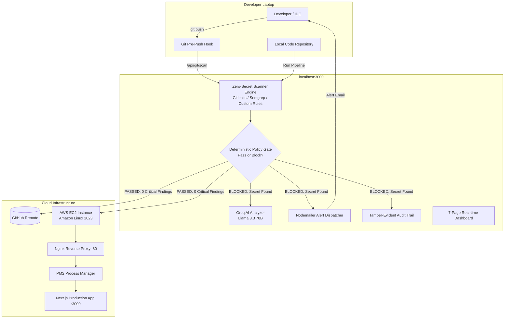

# SecureShip AI 🛡️

**AI-Enhanced Security-Gated Delivery Pipeline & Cloud Deployment System**

SecureShip AI is a production-grade CI/CD pipeline and dashboard that prevents vulnerable or secret-bearing code from ever reaching the cloud. It pairs a **deterministic policy release gate** with **automated AWS EC2 deployment**, **real-time email alerts**, and **Groq Llama 3.3 AI remediation guidance**.

---

## 🏛️ System Architecture



---

## 🚀 Key Features

### 1. Deterministic Security Release Gate
- Scans code for hardcoded AWS keys, GitHub tokens, Stripe secrets, private keys, and arbitrary execution vulnerabilities (`eval()`).
- **Zero-Secret Invariant**: Raw secret values are **never** logged, emailed, or stored in any database column. Findings store only one-way SHA-256 fingerprints, rule IDs, and line numbers.

### 2. Automated AWS EC2 Cloud Deployment
- Connects securely via IPv4 OpenSSH.
- Auto-detects Amazon Linux 2023 vs. Ubuntu.
- Configures 2.0 GB swap space to prevent out-of-memory kernel freezing on `t2.micro` instances.
- Auto-installs Node 22 (`nodejs22`), npm, Git, and PM2.
- Sets up an Nginx reverse proxy so the application is served on standard **Port 80** and **Port 3000**.
- Registers `pm2-ec2-user.service` with `systemd` for auto-boot resurrection across server restarts.

### 3. Developer Pre-Push Hook Guard
- Generates and installs a `.git/hooks/pre-push` interceptor directly from the dashboard.
- Any developer running `git push` in terminal is scanned locally before code can leave their computer.

### 4. Real Security Alert Emails
- Dispatches alert emails upon a blocked release gate.
- Supports production SMTP (SES, Gmail, SendGrid) and ephemeral test accounts (Ethereal.email with instant web preview).

### 5. Groq Llama 3.3 AI Security Advisor
- Generates advisory explanations and concrete remediation code for security findings.
- **Strict safety rule**: AI never alters the policy gate outcome; policy evaluation remains 100% deterministic.

---

## 💻 Quick Start

### 1. Prerequisites
- Node.js 22+
- Git

### 2. Install & Run Locally
```bash
# Clone the repository
git clone https://github.com/Ameer114/devsecure.git
cd devsecure

# Install dependencies (includes Prisma generation)
npm install

# Start development server
npm run dev
```

Visit the dashboard at [http://localhost:3000](http://localhost:3000).

---

## 🧪 Testing the Security Gate (Hero Demo)

### Method A: From the Dashboard (1-Click)
1. Open **[http://localhost:3000/configuration](http://localhost:3000/configuration)**.
2. Under **"Interactive Security Gate Demo"**, click **"Inject Test Leaked Secret"**.
3. Click **"Run Security & Deploy Pipeline"**:
   - SecureShip detects the AWS key.
   - The release gate halts deployment and keeps AWS untouched.
   - Groq AI provides the fix.
   - An alert email is dispatched.
4. Click **"Clean Up Test Secret"** $\rightarrow$ **"Run Security & Deploy Pipeline"**:
   - The gate passes and the code deploys to AWS EC2!

### Method B: Via Developer Terminal Hook
1. Click **"Install Pre-Push Guard Hook"** on the Configuration page.
2. In your terminal, attempt to push any branch:
   ```bash
   git push origin main
   ```
   If a secret exists in your project, git push is aborted immediately.

---

## 📋 Verification & Test Suite

```bash
# Run unit & integration tests (20 passed)
npm test

# Run TypeScript typecheck (0 errors)
npm run typecheck

# Run ESLint (0 errors)
npm run lint
```

---

## 🔒 Security Design Principles Enforced

1. **No secret values stored**: Findings only contain SHA-256 digests and file metadata.
2. **Redacted telemetry**: All logs and audit metadata redact sensitive keys (`token`, `password`, `key`, `authorization`).
3. **Deterministic policy**: AI is advisory only; release gate passes or fails based strictly on rule matching.
